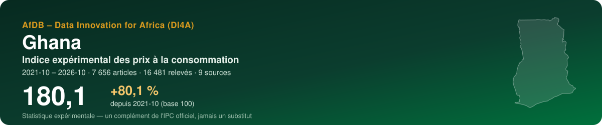
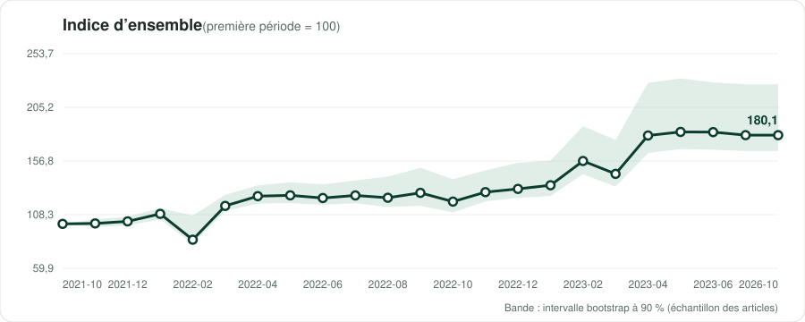
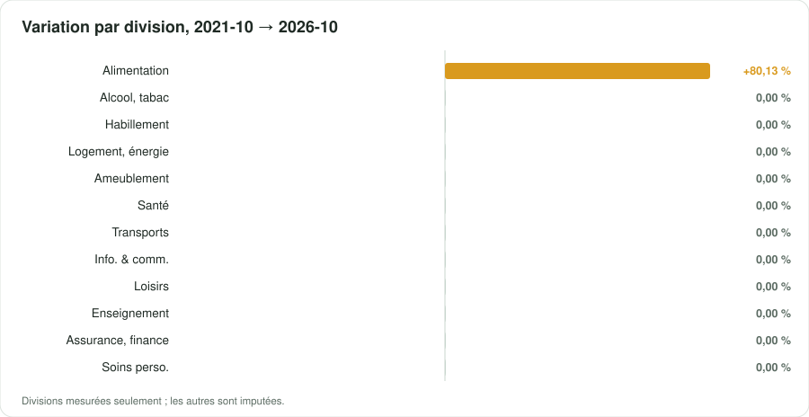

<p align="center"></p>

<p align="center">
  <a href="https://datainnov4africa-web.github.io/cpi-gh/"><b>▶ Ouvrir le tableau de bord</b></a> · <a href="README.md">English version</a>
</p>

<p align="center">
      
</p>

## En bref

| Indicateur | Valeur |
|---|---|
| **Indice d'ensemble** | **180,1** (+80,1 % depuis 2021-10) |
| Variation de la dernière période | +0,00 % |
| Fenêtre | 2021-10 → 2026-10 · mensuel |
| Données | 16 481 relevés · 7 656 articles · 9 sources |
| Divisions COICOP mesurées | 1 / 13 |
| Pondérations | officielles — GSS CPI bulletins, Weight column of Tables 3-4 (April 2022, then '2018 = 100' series; identical in May 2022). Sums to 100.02 (rounding). Wei |
| Devise | GHS (GH₵) |

> [!IMPORTANT]
> Statistique expérimentale construite à partir de prix publiés en ligne (boutiques, régulateurs, services publics, données de marché). Un complément de l'indice officiel des prix de l'institut national de la statistique — jamais un substitut.

<p align="center"></p>

## Messages clés

| Confiance | Message | Pourquoi |
|---|---|---|
| 🟢 Élevée | Entre 2021-10 et 2026-10, l'indice expérimental a varié de +80,1 % (23 périodes, 7656 articles). | Plusieurs mois observés. |
| 🟡 Moyenne | Sur la dernière période, la plus forte contribution vient de la division 01 (Produits alimentaires et boissons non alcoolisées) : -1,50 point de pourcentage. | Les contributions s'additionnent exactement à la variation de l'indice d'ensemble. |
| 🟠 Faible | Les divisions mesurées pèsent 43 % du panier officiel. | Être atteint n'est pas être représenté : un groupe peut être suivi par quelques articles en ligne éloignés de ses variétés officielles. Les groupes non mesurés sont imputés par ceux qui le sont. |
| 🟢 Élevée | La formule de Carli finit à +307,2 points du Jevons sur les mêmes données. | C'est pourquoi le Manuel de l'IPC recommande le Jevons au niveau élémentaire. |
| 🟡 Moyenne | Échantillonnage des articles : le dernier indice se situe entre 165,7 et 226,0 dans 90 % de 100 réplications bootstrap. | L'intervalle couvre le choix des articles collectés, pas le biais des prix en ligne face aux prix en magasin. |

## Par division COICOP

<p align="center"></p>

| | Division | Poids % | Articles | Variation % | Contribution, dernière période (pt) |
|---|---|---:|---:|---:|---:|
| 01 | Produits alimentaires et boissons non alcoolisées | 43,1 | 1116 | +80,13 | — |
| 02 | Boissons alcoolisées, tabac et stupéfiants | 3,7 | 22 | 0,00 | — |
| 03 | Articles d'habillement et chaussures | 8,1 | 1528 | 0,00 | — |
| 04 | Logement, eau, électricité, gaz et autres combustibles | 10,2 | 186 | 0,00 | — |
| 05 | Meubles, équipements ménagers et entretien courant | 3,2 | 1430 | 0,00 | — |
| 06 | Santé | 0,7 | 245 | 0,00 | — |
| 07 | Transports | 10,1 | 331 | 0,00 | — |
| 08 | Information et communication | 3,6 | 838 | 0,00 | — |
| 09 | Loisirs, sports et culture | 3,5 | 372 | 0,00 | — |
| 10 | Services d'enseignement | 6,5 | 2 | 0,00 | — |
| 11 | Restaurants et services d'hébergement | 4,6 | — | imputée | — |
| 12 | Assurances et services financiers | 0,2 | 14 | 0,00 | — |
| 13 | Soins personnels, protection sociale et divers | 2,4 | 1572 | 0,00 | — |

*Imputée* : aucun prix lu pour la division ; elle évolue comme les divisions mesurées (Manuel de l'IPC 2020, ch. 6).

## Sources

14 sources actives au registre, 7 exclues avec leur motif. Chaque requête du robot lit d'abord le robots.txt ; un refus est consigné, jamais contourné.

| Source | Type | COICOP | Statut | Relevés de cette exécution |
|---|---|---|---|---:|
| [Jumia Ghana](https://www.jumia.com.gh) | boutique en ligne | 01, 02, 03, 05, 08, 13 | vérifiée | 16 399 |
| [MTN Ghana — data tariffs](https://mtn.com.gh/insight/tariffs/) | tarif réglementé | 08 | partielle | 32 |
| [NHIS Medicines List — reimbursement prices](https://nhis.gov.gh/medlist) | tarif réglementé | 06 | vérifiée | 21 |
| [MTN Ghana — Turbonet fixed broadband bundles](https://mtn.com.gh/insight/tariffs/) | tarif réglementé | 08 | partielle | 7 |
| [GPRTU / GRTCC — road transport fares (trotro, shared taxi, inter-city)](https://www.myjoyonline.com/public-transport-fares-go-up-by-8-from-september-26-check-how-much-you-will-pay/) | tarif réglementé | 07 | partielle | 7 |
| [PURC — gazetted electricity and water tariffs (quarterly)](https://www.purc.com.gh/attachment/67864-20261001121001.pdf) | tarif réglementé | 04 | vérifiée | 6 |
| [NPA — fuel price floors (twice a month)](https://npa.gov.gh/price-floor/) | tarif réglementé | 07, 04 | partielle | 4 |
| [MTN MoMo — cash-out fees](https://help-center.mtn.com.gh/hc/en-us/articles/17409333034130-What-are-the-new-cash-out-fees) | tarif réglementé | 12 | partielle | 3 |
| [University of Ghana — fee schedules](https://www.ug.edu.gh/aad/sites/academic.ug.edu.gh/files/2026-01/2025_26%20COLLEGE%20OF%20HUMANITIES%20FEES.pdf) | tarif réglementé | 10 | vérifiée | 2 |
| [Melcom online (Magento)](https://melcom.com) | boutique en ligne | 01, 02, 05, 08, 09, 13 | vérifiée | 0 |
| [Jiji Ghana — used cars and goods](https://jiji.com.gh/cars) | petites annonces | 07 | partielle | 0 |
| [WFP market prices (HDX)](https://data.humdata.org/dataset/wfp-food-prices-for-ghana) | prix de marché | 01 | partielle | 0 |
| [World Bank — official CPI (annual)](https://api.worldbank.org/v2/country/GHA/indicator/FP.CPI.TOTL) | référence officielle | — | vérifiée | 0 |
| [IMF DataMapper — inflation (WEO)](https://www.imf.org/external/datamapper/api/v1/PCPIPCH/GHA) | référence officielle | — | vérifiée | 0 |

<details><summary>7 sources exclues et pourquoi</summary>

- **Shoprite Ghana** — Shoprite a quitté le Ghana en 2025.
- **Glovo Ghana** — Glovo a cessé ses activités au Ghana en mai 2024. Bolt Food reste (application JavaScript, robots illisible) : la division 11 n'a pas de source automatisée.
- **Meqasa rents** — 5 373 résultats annoncés, mais les annonces se chargent en JavaScript et les loyers sont souvent en USD.
- **WekuYummy (Tema) — restaurant menus** — Non représentatif et plus listé : le 28 oct. 2026 la page d'accueil n'affiche que trois pharmacies, Jay's Pub a disparu et le motif ne trouve rien. Le menu d'un pub de Tema (ex. Eagle Extra Stout 18,00 GHS le 21 oct.) ne peut représenter restaurants et hôtels (4,6 %) : la division 11 est déclarée lacune et imputée.
- **FEWS NET market prices** — Aucun indice que FEWS NET publie des prix de marchés ghanéens : son bulletin des prix d'Afrique de l'Ouest (mai 2021) ne montre aucun marché ghanéen (le Ghana n'apparaît que dans le texte sur les bassins commerciaux), et deux recherches n'ont trouvé aucune série. Retester avec le collecteur fews_net (country_code GH) depuis un poste avant usage.
- **World Bank RTFP** — Le Ghana ne fait pas partie des 37 pays du jeu Real-Time Food Prices (version du 24/08/2026, données jusqu'à 2026-08).
- **Esoko market prices** — Service commercial SMS/agritech : le site n'affiche ni flux de prix public ni dates ; les rapports hebdomadaires Esoko repris par Graphic (Agbogbloshie, Kumasi, Techiman…) datent de 2015. Les prix de marché du MoFA-SRID n'ont pas été trouvés en ligne.

</details>

## Méthode

Articles appariés ; indices élémentaires de **Jevons** par classe COICOP 2018, points de vente en strates de poids égal ; imputation explicite des prix manquants (deux périodes au plus, onze pour les produits saisonniers) ; remplacements raccordés avec ajustement de quantité ; agrégation avec les poids officiels sous forme **Young/Lowe**, chaînée ; GEKS pour contrôler la dérive de chaînage ; intervalle bootstrap à 90 %. Comme le prescrit le *Manuel de l'indice des prix à la consommation* (FMI et al., 2020). Détails : [docs/METHODOLOGIE.md](docs/METHODOLOGIE.md).

## Données

Copies ouvertes, lisibles par machine, de ce que montre le tableau de bord :

- [`data/index_all_items.csv`](data/index_all_items.csv) — indice d'ensemble par période, avec son intervalle à 90 %
- [`data/index_divisions.csv`](data/index_divisions.csv) — indice de chaque division mesurée
- [`data/contributions.csv`](data/contributions.csv) — contributions des divisions à chaque variation, en points
- [`data/basket.csv`](data/basket.csv) — poids, articles et variation par division
- [`data/sources.csv`](data/sources.csv) — le registre des sources et ce que l'exécution a obtenu de chacune
- [`data/metadata.json`](data/metadata.json) — pays, périodes, pondérations et chiffres clés

## Reproduire

L'indice est produit par la boîte à outils ouverte **cpi-di4a** en deux notebooks : le notebook 1 collecte poliment les prix (robots.txt d'abord, robot identifié) et les scelle dans une archive ; le notebook 2 classe, calcule et publie ce dépôt. Choisissez le code pays, *Exécution → Tout exécuter*.

## Citer

```text
AfDB – Data Innovation for Africa (DI4A) (2026). Indice expérimental des prix à la consommation — Ghana. https://datainnov4africa-web.github.io/cpi-gh/
```

Voir aussi [CITATION.cff](CITATION.cff).

---

<p align="center"><sub>AfDB – Data Innovation for Africa (DI4A) · généré le 2026-10-29 · code sous licence MIT ; les données collectées restent soumises aux conditions de chaque source</sub></p>
