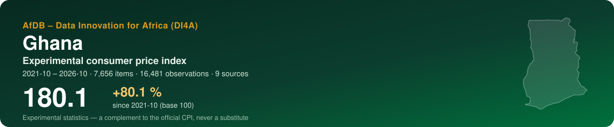
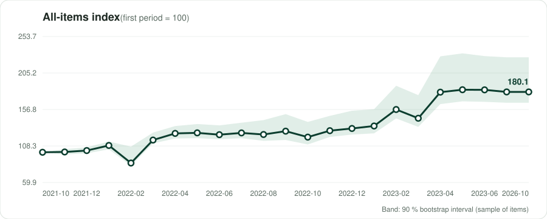
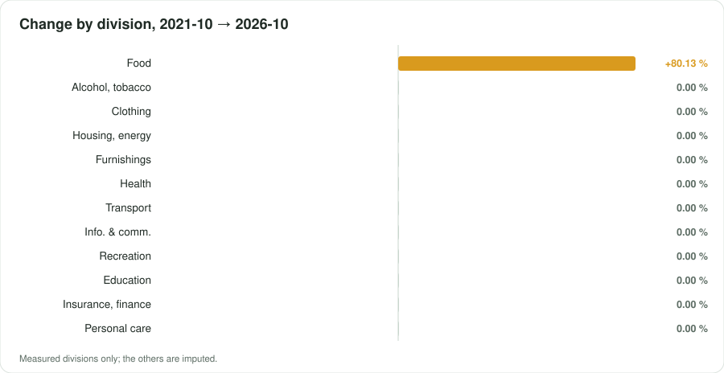

<p align="center"></p>

<p align="center">
  <a href="https://datainnov4africa-web.github.io/cpi-gh/"><b>▶ Open the live dashboard</b></a> · <a href="README.fr.md">Version française</a>
</p>

<p align="center">
      
</p>

## At a glance

| Indicator | Value |
|---|---|
| **All-items index** | **180.1** (+80.1 % since 2021-10) |
| Last period change | +0.00 % |
| Window | 2021-10 → 2026-10 · monthly |
| Data | 16,481 observations · 7,656 items · 9 sources |
| COICOP divisions measured | 1 / 13 |
| Weights | official — GSS CPI bulletins, Weight column of Tables 3-4 (April 2022, then '2018 = 100' series; identical in May 2022). Sums to 100.02 (rounding). Wei |
| Currency | GHS (GH₵) |

> [!IMPORTANT]
> Experimental statistics built from prices published online (shops, regulators, utilities, market data). A complement to the official consumer price index of the national statistics office — never a substitute.

<p align="center"></p>

## Key messages

| Confidence | Message | Why |
|---|---|---|
| 🟢 High | Between 2021-10 and 2026-10, the experimental index moved by +80.1 % (23 periods, 7656 items). | Several months observed. |
| 🟡 Medium | Over the last period, the largest contribution comes from division 01 (Food and non-alcoholic beverages): -1.50 percentage point. | Contributions add up exactly to the change of the all-items index. |
| 🟠 Low | The divisions measured weigh 43 % of the official basket. | Being reached is not being represented: a group can be followed through a few online items far from its official varieties. Unmeasured groups are imputed by the measured ones. |
| 🟢 High | The Carli formula ends +307.2 points away from the Jevons on the same data. | This is why the CPI Manual recommends the Jevons at the elementary level. |
| 🟡 Medium | Sampling of items: the latest index lies between 165.7 and 226.0 in 90 % of 100 bootstrap replications. | The interval covers which items were collected, not the bias of online prices against shop prices. |

## By COICOP division

<p align="center"></p>

| | Division | Weight % | Items | Change % | Contribution, last period (pp) |
|---|---|---:|---:|---:|---:|
| 01 | Food and non-alcoholic beverages | 43.1 | 1116 | +80.13 | — |
| 02 | Alcoholic beverages, tobacco and narcotics | 3.7 | 22 | 0.00 | — |
| 03 | Clothing and footwear | 8.1 | 1528 | 0.00 | — |
| 04 | Housing, water, electricity, gas and other fuels | 10.2 | 186 | 0.00 | — |
| 05 | Furnishings, household equipment and maintenance | 3.2 | 1430 | 0.00 | — |
| 06 | Health | 0.7 | 245 | 0.00 | — |
| 07 | Transport | 10.1 | 331 | 0.00 | — |
| 08 | Information and communication | 3.6 | 838 | 0.00 | — |
| 09 | Recreation, sport and culture | 3.5 | 372 | 0.00 | — |
| 10 | Education services | 6.5 | 2 | 0.00 | — |
| 11 | Restaurants and accommodation services | 4.6 | — | imputed | — |
| 12 | Insurance and financial services | 0.2 | 14 | 0.00 | — |
| 13 | Personal care, social protection and miscellaneous | 2.4 | 1572 | 0.00 | — |

*Imputed*: no price was read for the division; it moves with the measured ones (CPI Manual 2020, ch. 6).

## Sources

14 active sources in the register, 7 excluded with their reason. Every robot request reads robots.txt first; a refusal is recorded, never circumvented.

| Source | Type | COICOP | Status | Observations this run |
|---|---|---|---|---:|
| [Jumia Ghana](https://www.jumia.com.gh) | online shop | 01, 02, 03, 05, 08, 13 | verified | 16,399 |
| [MTN Ghana — data tariffs](https://mtn.com.gh/insight/tariffs/) | regulated tariff | 08 | partial | 32 |
| [NHIS Medicines List — reimbursement prices](https://nhis.gov.gh/medlist) | regulated tariff | 06 | verified | 21 |
| [MTN Ghana — Turbonet fixed broadband bundles](https://mtn.com.gh/insight/tariffs/) | regulated tariff | 08 | partial | 7 |
| [GPRTU / GRTCC — road transport fares (trotro, shared taxi, inter-city)](https://www.myjoyonline.com/public-transport-fares-go-up-by-8-from-september-26-check-how-much-you-will-pay/) | regulated tariff | 07 | partial | 7 |
| [PURC — gazetted electricity and water tariffs (quarterly)](https://www.purc.com.gh/attachment/67864-20261001121001.pdf) | regulated tariff | 04 | verified | 6 |
| [NPA — fuel price floors (twice a month)](https://npa.gov.gh/price-floor/) | regulated tariff | 07, 04 | partial | 4 |
| [MTN MoMo — cash-out fees](https://help-center.mtn.com.gh/hc/en-us/articles/17409333034130-What-are-the-new-cash-out-fees) | regulated tariff | 12 | partial | 3 |
| [University of Ghana — fee schedules](https://www.ug.edu.gh/aad/sites/academic.ug.edu.gh/files/2026-01/2025_26%20COLLEGE%20OF%20HUMANITIES%20FEES.pdf) | regulated tariff | 10 | verified | 2 |
| [Melcom online (Magento)](https://melcom.com) | online shop | 01, 02, 05, 08, 09, 13 | verified | 0 |
| [Jiji Ghana — used cars and goods](https://jiji.com.gh/cars) | classifieds | 07 | partial | 0 |
| [WFP market prices (HDX)](https://data.humdata.org/dataset/wfp-food-prices-for-ghana) | market prices | 01 | partial | 0 |
| [World Bank — official CPI (annual)](https://api.worldbank.org/v2/country/GHA/indicator/FP.CPI.TOTL) | official benchmark | — | verified | 0 |
| [IMF DataMapper — inflation (WEO)](https://www.imf.org/external/datamapper/api/v1/PCPIPCH/GHA) | official benchmark | — | verified | 0 |

<details><summary>7 excluded sources and why</summary>

- **Shoprite Ghana** — Shoprite left Ghana in 2025.
- **Glovo Ghana** — Glovo stopped operating in Ghana in May 2024. Bolt Food remains (JavaScript app, robots not readable): division 11 has no automated source.
- **Meqasa rents** — 5,373 results announced, but listings load in JavaScript and rents are often quoted in USD.
- **WekuYummy (Tema) — restaurant menus** — Not representative and no longer listed: on 28 Oct 2026 the platform's home page shows only three pharmacy stores, Jay's Pub is gone and the pattern matches nothing. One pub menu in Tema (e.g. Eagle Extra Stout GHS 18.00 on 21 Oct) cannot stand for restaurants and hotels (4.6 %): division 11 is declared a gap and imputed.
- **FEWS NET market prices** — No evidence that FEWS NET publishes Ghanaian market prices: its West Africa Price Bulletin (May 2021) charts no Ghanaian market (Ghana appears only in the trade-basin text), and two searches found no Ghana price series. Re-test with the fews_net collector (country_code GH) from a workstation before using it.
- **World Bank RTFP** — Ghana is not among the 37 countries of the Real-Time Food Prices dataset (version 2026/08/24, data to 2026-08).
- **Esoko market prices** — Commercial SMS/agritech service: the site shows no public price feed or dates; the weekly Esoko market reports reprinted by Graphic (Agbogbloshie, Kumasi, Techiman…) date from 2015. MoFA-SRID market prices were not found online.

</details>

## Method

Matched items; elementary **Jevons** indices by COICOP 2018 class, outlets as equal-weight strata; explicit imputation of missing prices (two periods at most, eleven for seasonal items); replacements linked with a quantity adjustment; aggregation with official weights in the **Young/Lowe** form, chained; GEKS as a chain-drift check; a 90 % bootstrap interval. As prescribed by the *Consumer Price Index Manual: Concepts and Methods* (IMF et al., 2020). Details: [docs/METHODOLOGY.md](docs/METHODOLOGY.md).

## Data

Open, machine-readable copies of what the dashboard shows:

- [`data/index_all_items.csv`](data/index_all_items.csv) — all-items index by period, with its 90 % interval
- [`data/index_divisions.csv`](data/index_divisions.csv) — index of each measured division
- [`data/contributions.csv`](data/contributions.csv) — contributions of the divisions to each change, in percentage points
- [`data/basket.csv`](data/basket.csv) — weights, items and change by division
- [`data/sources.csv`](data/sources.csv) — the source register and what this run obtained from each source
- [`data/metadata.json`](data/metadata.json) — country, periods, weights and key figures

## Reproduce

The index is produced by the open toolkit **cpi-di4a** in two notebooks: notebook 1 collects prices politely (robots.txt first, identified robot) and seals them in an archive; notebook 2 classifies, computes and publishes this repository. Set the country code, *Runtime → Run all*.

## Cite

```text
AfDB – Data Innovation for Africa (DI4A) (2026). Experimental consumer price index — Ghana. https://datainnov4africa-web.github.io/cpi-gh/
```

See also [CITATION.cff](CITATION.cff).

---

<p align="center"><sub>AfDB – Data Innovation for Africa (DI4A) · generated on 2026-10-29 · code under MIT licence; collected data remain subject to each source's terms</sub></p>
